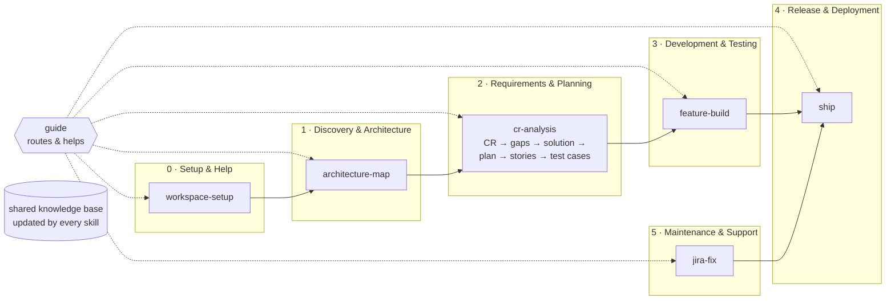

# Engineering Skills

Seven step-by-step AI skills covering the software engineering lifecycle — used from **VS Code** with
Claude Code or GitHub Copilot. The skills live in one place (`src/skills/`) and are installed as links, so
there's only ever one copy. Your team's knowledge (projects, knowledge base, CRs) lives in a
separate **team workspace** repo that the skills create and maintain.

## Install

**macOS / Linux**
```bash
curl -fsSL https://raw.githubusercontent.com/mrgurdeep/engineering-skills/main/install.sh | bash
```
**Windows (PowerShell)**
```powershell
irm https://raw.githubusercontent.com/mrgurdeep/engineering-skills/main/install.ps1 | iex
```

| What | Where | How |
|---|---|---|
| Skills repo (the only copy) | `~/engineering-skills` (`%USERPROFILE%\engineering-skills`) | `git clone`; re-run the installer to update |
| Skills for Claude Code **and** VS Code Copilot | `~/.claude/skills/<skill>` | symlink (macOS/Linux) · junction (Windows, no admin) |
| Shared rules | `~/.claude/CLAUDE.md` | one import line `@~/engineering-skills/src/AGENTS.md` |
| `ENG_SKILLS_HOME` | shell rc / user env var | points at the skills repo |
| Browser for Jira/Confluence/Figma | MCP server `eng-browser` (user level, Claude Code + VS Code) | Playwright, login session in `~/.config/engineering-skills/browser-profile` |

Options: `--dir <path>` / `-Dir`, `--branch` / `-Branch`, `--no-mcp` / `-NoMcp`, `--uninstall` / `-Uninstall`.
Needs git and Node 18+ (for the browser). Git Bash on Windows is handed to the PowerShell installer.

> **CR** = Change Request document — the Confluence page describing the change to build.

## First run → team workspace

The first time you use any skill, `workspace-setup` asks:
1. **Where is the team workspace?** Join an existing one (git URL) or create a new one.
2. **Which projects?** Then the **git repo** of each (plus optional Jira / Confluence / Figma links).
3. It clones the code into `local/repos/` (git-ignored — never shared), **reads it**, and builds the shared knowledge base.

```
<workspace>/                     # a git repo the whole team shares (KB, flows, CRs)
  workspace.yaml                 # projects + git URLs + Jira/Confluence/Figma links
  knowledge-base/
    README.md                    # index
    system-landscape.md          # every project and how they connect (Mermaid)
    interdependencies/a--b.md    # one readable page per dependency (sequence diagram + contract)
    projects/<id>/               # overview, architecture (C4 in Mermaid), modules, APIs, data model, ADRs, features, known issues
    glossary.md
  crs/<project>/<feature>/       # CR → gaps → solution → plan → stories → test cases → build → ship
  fixes/<project>/<KEY>/         # jira-fix notes: root cause, fix, tests
  local/                         # NOT shared (git-ignored): repos/<id> clones + overrides.yaml
```

## New here? Ask the guide
Not sure what to use? Just describe what you need to **`guide`** (Claude Code: *"guide: I need to fix SHOP-123"*,
Copilot: `/guide …`). It picks the right skill, confirms with you and runs it. Say *"help"* or *"give me a tour"*
for a short training session: the SDLC phases, the safety rules and a read-only walkthrough on one of your projects.

## Skills by SDLC phase (7)

| SDLC phase | Skill | Use it when… | Typical roles | You get (in the workspace) |
|---|---|---|---|---|
| **0 · Setup & Help** | `guide` | unsure which skill, need help or training, have a question | everyone | answer / right skill running |
| **0 · Setup & Help** | `workspace-setup` | first time, joining the team, adding projects | tech lead, eng manager | `workspace.yaml`, clones in `local/`, system landscape |
| **1 · Discovery & Architecture** | `architecture-map` | onboarding a repo, code changed a lot, need diagrams | architect, tech lead, new joiners | `knowledge-base/projects/<id>/`, interdependency pages |
| **2 · Requirements & Planning** | `cr-analysis` | you have a CR document in Confluence | BA / product owner, tech lead, QA | requirements, gaps, solution & changes, plan, Jira stories, test cases in `crs/` |
| **3 · Development & Testing** | `feature-build` | stories are ready to build | developer, QA | code, tests, review notes |
| **4 · Release & Deployment** | `ship` | code is ready for a PR / release | developer, DevOps / release manager | PR + green CI, release notes, Confluence/Jira updated |
| **5 · Maintenance & Support** | `jira-fix` | you have a Jira bug/ticket | developer, support / L3, QA | root cause, fix, PR, Jira comment; notes in `fixes/` |

Every skill is a short `SKILL.md` plus numbered `steps/`; it stops at ⏸ checkpoints for your approval.
Shared building blocks used by several skills live in `src/shared/` (pick project, browser login wait, KB update).

## The flow



## Browser & login
Jira, Confluence and Figma open in a visible browser window (`eng-browser`) that the agent can read; view the
same page inside VS Code with **Command Palette → Simple Browser: Show** (VS Code's built-in browser can't be
read by agents). When a login/SSO/MFA page appears, the agent stops and asks you to sign in yourself, then
continues when you reply **done** — it never handles your credentials. If you connect the Atlassian or Figma
MCP servers, skills use those instead.

## Repository layout
```
src/AGENTS.md            shared rules (skills by SDLC phase, HUB vs WS, approvals, login wait)
src/skills/<skill>/      7 skills: SKILL.md (index) + steps/NN-*.md
src/shared/              procedures reused by skills: pick-project · browser-login · kb-update
src/templates/           artifact templates + workspace/ skeleton
src/scripts/             validate_skills.py · kb_check.py
install.sh · install.ps1
```
Change a skill → edit `src/skills/<skill>/…`, run `python3 src/scripts/validate_skills.py`, open a PR.
