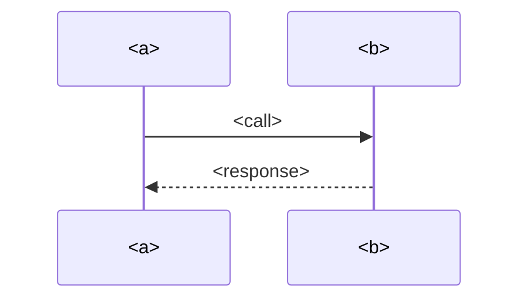

# <a> → <b>

**What:** <a> uses <b> for … · **How:** REST / GraphQL / events / shared DB / shared package · **Criticality:** high|med|low

## Contract
| Endpoint / topic | Caller file | Provider file | Auth | Notes |
|---|---|---|---|---|

## Failure modes & ownership
## Related
- [System landscape](../system-landscape.md)
